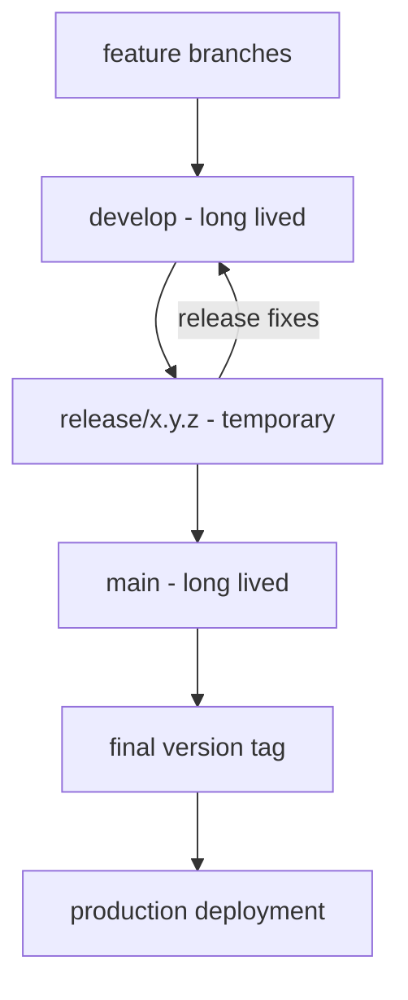
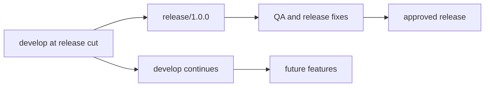
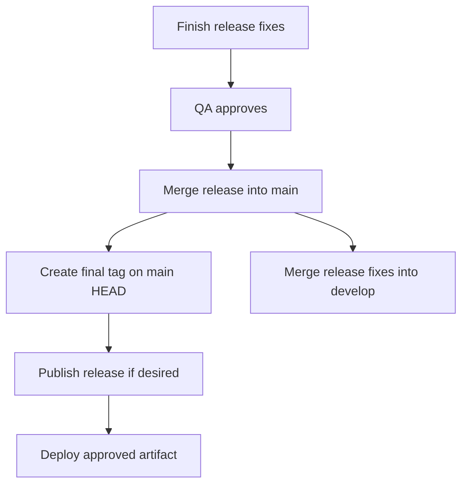

**The central idea:** Keep development moving while stabilizing a specific version for production. GitFlow achieves this with two long-lived branches (`main` and `develop`) and temporary feature, release, and hotfix branches.


## 1. Branches, tags, and GitHub Releases

A **branch** is a movable reference to a commit. A **tag** is usually a stable reference to a particular commit. A **GitHub Release** is a publication associated with a tag; it can contain release notes and downloadable assets. None of these alone proves a successful production deployment.

| Concept | Example | Role |
| --- | --- | --- |
| Branch | `develop`, `main`, `release/1.1.0` | Moving development history |
| Git tag | `v1.1.0` | Identifies an exact Git object, normally a commit |
| GitHub Release | Release `v1.1.0` | Publishes release information and optional assets |
| Deployment record | Production running `v1.1.0` | Tracks what was actually deployed |

Tags do **not** belong to branches. `git tag v1.1.0` tags your current `HEAD`, while `git tag v1.1.0 <commit-sha>` tags an explicit commit. A tag name must be unique in the repository's tag namespace.

```bash
# Inspect local and remote tags
git tag -l
git show v1.1.0
git ls-remote --tags origin
```

If Git reports that a tag already exists during a merge workflow, investigate your release automation: merging a PR does not normally create a tag. Avoid force-moving published release tags because builds and deployments may depend on them.

## 2. Why both main and develop exist

Classic GitFlow maintains two **permanent** branches:

- **`main`** represents approved release history.
- **`develop`** integrates ongoing feature work for future releases.

You create `develop` once, not after every deployment. Feature branches are typically created from `develop` and merged back when ready.



**Why not recreate `develop` from `main` after every deployment?** Because developers may already have merged features for the *next* release into `develop`. Recreating it from `main` would not automatically preserve those unreleased features.

## 3. When to create a release branch

Create `release/1.0.0` from `develop` when the **scope of version 1.0.0** is ready for final stabilization. This does not mean all future features must be finished, and it does not mean testing starts only now.

```bash
git switch develop
git pull origin develop
git switch -c release/1.0.0
git push -u origin release/1.0.0
```

After cutting the branch:

- `develop` continues accepting features for later versions.
- `release/1.0.0` accepts only necessary release-blocking fixes and release preparation changes.
- QA tests a stable release candidate rather than a moving target.



**Do not routinely merge `develop` into a stabilizing release branch.** That can pull in incomplete features and invalidate QA results. Merging *release fixes back into `develop`* is a different, useful direction of synchronization.

## 4. How parallel testing works

**A Git branch is not an environment.** CI/CD can deploy code from feature branches, `develop`, release branches, or pinned commits to different environments.

| Environment | Typical source | Purpose |
| --- | --- | --- |
| Feature preview | `feature/*` or pinned commit | Isolated feature validation |
| DEV / integration | `develop` | Continuous integration and early testing |
| QA / UAT / staging | `release/*` or pinned release candidate | Stable final regression and acceptance testing |
| Production | Approved tag and immutable artifact | Run approved software |

Suppose feature C is complete while D and E are still being developed. QA can test C in a feature preview or integration environment **without** waiting for a release branch. Once the scope is ready, create a release branch and perform final QA there.

If D and E are already merged into `develop`, creating a release branch from its current tip includes them too. To ship only C, consider feature flags, keeping incomplete work off the integration branch, or deliberately selecting an earlier commit. That last choice is a selective-release variation, not the standard GitFlow path.

A shared DEV environment may change as new commits land. For repeatable testing, pin a build or use an isolated environment.

## 5. Why release fixes must return to develop

Imagine `release/1.0.0` is cut after features C, D, and E. QA finds bugs and adds fixes R1 and R2. Meanwhile, developers add feature F to the **same long-lived** `develop` branch.

```text
                C---D---E---F             develop
               /       \
A---B---------/         R1---R2          release/1.0.0
     \
      (main remains on the previous release)
```

The release must be integrated into **both** `main` and `develop`:

1. `main` receives the approved version for production.
2. `develop` receives R1 and R2 so future releases do not lose those fixes.
3. Feature F remains on `develop`; it is not thrown away.

```bash
# After final QA approval, integrate the release into main
git switch main
git merge --no-ff release/1.0.0

# Preserve QA fixes in ongoing development
git switch develop
git merge --no-ff release/1.0.0
```

Conflicts may require resolution and retesting. The release-to-`develop` merge can also occur during QA instead of waiting until production deployment.

### Must all three branches point to the same commit?

**No.** `main` may point to merge commit M1, `release/1.0.0` to its last fix R2, and `develop` to a different merge commit M2 containing both release fixes and future features. Git commit identity and code content are different things. What matters is that the appropriate changes are present.

## 6. Hotfixes and active release branches

A hotfix starts from `main` because it must repair the **currently released** code, without accidentally including unfinished development.

```bash
git switch main
git switch -c hotfix/1.0.1
# Edit, test, and commit the fix
git add .
git commit -m "Fix production issue"

git switch main
git merge --no-ff hotfix/1.0.1
git tag -a v1.0.1 -m "Hotfix 1.0.1"
```

Without an active release branch, merge the hotfix into `develop`:

```bash
git switch develop
git merge --no-ff hotfix/1.0.1
```

**If a release branch is already active**, the original GitFlow convention commonly merges the hotfix into that release branch, which later merges back into `develop`. If `develop` needs the fix sooner, it can receive the hotfix directly too. The crucial rule is that **every relevant future release line must receive the production fix**.

Cherry-picking a fix is possible but creates a new commit with different ancestry. Merging `main` into `develop` is also valid if you want *all* changes missing from `develop`, not just the hotfix.

## 7. When to tag and deploy

In classic GitFlow, the common sequence is:



Example:

```bash
git switch main
git merge --no-ff release/1.0.0
git tag -a v1.0.0 -m "Release v1.0.0"
git push origin main
git push origin v1.0.0

# Integrate release fixes back into the existing develop branch
git switch develop
git merge --no-ff release/1.0.0
git push origin develop

# Once both merges are complete
git branch -d release/1.0.0
```

You can create release-candidate tags such as `v1.0.0-rc.1` during QA. The final tag conventionally points to the approved commit on `main`.

**A tag does not prove deployment succeeded.** A failed production rollout can leave a perfectly valid tag. Track deployment status separately, and preferably promote the *same tested artifact* rather than rebuilding different binaries for QA and production.

## 8. The complete lifecycle

| Phase | Action |
| --- | --- |
| Initialize | Create long-lived `main` and `develop` once |
| Build | Merge completed feature branches into `develop`; test continuously |
| Cut release | Create temporary `release/x.y.z` from the chosen `develop` commit |
| Stabilize | Final QA; fix release-blocking defects on the release branch |
| Publish | Merge into `main`, create final tag, optionally publish GitHub Release |
| Deploy | Deploy the approved build and record the actual production version |
| Reconcile | Merge release fixes into the **existing** `develop` branch |
| Continue | Delete temporary release branch; keep developing the next version |

## 9. Common misconceptions

**“We create a new `develop` after every deployment.”** No. `develop` is permanent and preserves future work.

**“Testing requires a release branch.”** No. Feature and integration testing can happen earlier in separate environments.

**“Keep `develop` and `release` continuously identical.”** Usually a mistake. New features entering `develop` should not automatically enter an already stabilizing release.

**“`main`, `release`, and `develop` must share the same HEAD at deployment.”** No. They need the appropriate fixes, not identical commit IDs.

**“Tags belong to `main`.”** No. Tags reference Git objects; placing final tags on approved `main` commits is a GitFlow convention.

**“A GitHub Release means production was deployed.”** No. Publication and deployment are separate operations.

## 10. When not to use GitFlow

GitFlow is useful for planned release cycles, longer QA windows, and distinct production maintenance. If your team deploys frequently and wants features to ship independently, **trunk-based development** with short-lived branches, feature flags, automated tests, and immutable artifact promotion may be simpler.

The right branching strategy follows your delivery cadence and testing constraints—not a universal requirement to have `develop` and `release` branches.

---

### Further reading

- [Vincent Driessen — A successful Git branching model](https://nvie.com/posts/a-successful-git-branching-model/)
- [Git documentation — git-tag](https://git-scm.com/docs/git-tag)
- [GitHub Docs — About releases](https://docs.github.com/en/repositories/releasing-projects-on-github/about-releases)
