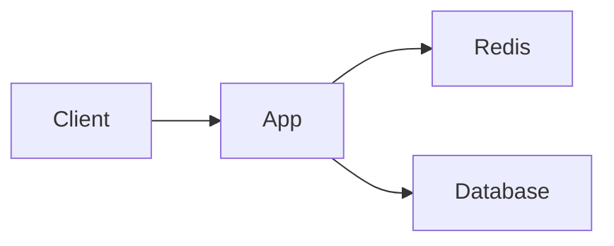

Redis is an in-memory data store often used as a cache in front of a slower source of truth. A cache can reduce latency and database load, but it adds another copy of data whose freshness must be managed.

## The cache-aside pattern

The application reads Redis first. On a miss it reads the database, writes the result to Redis with a time-to-live (TTL), and returns it. On a hit it avoids the database read.



```text
value = cache.get(key)
if value is missing:
    value = database.read(key)
    cache.set(key, value, ttl=60 seconds)
return value
```

## Freshness is a design decision

A TTL bounds how long an untouched cache entry remains, but it is not a complete consistency protocol. A common write path updates the database and invalidates the cached key. Concurrent readers can still race with invalidation and repopulate stale data, so strict correctness may require versioning or stronger coordination. Decide what staleness is acceptable before choosing a strategy.

## Plan for misses and failure

Many requests for the same expired key can stampede the database. Request coalescing, TTL jitter, and carefully designed stale-while-revalidate strategies can reduce that pressure. Configure memory limits and an eviction policy appropriate to the workload; monitor hit rate, latency, evictions, and database load. Redis being unavailable should have an explicit, capacity-tested fallback.
