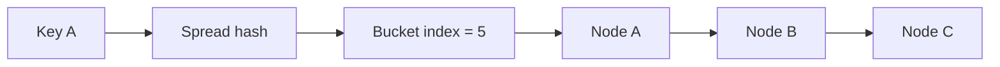
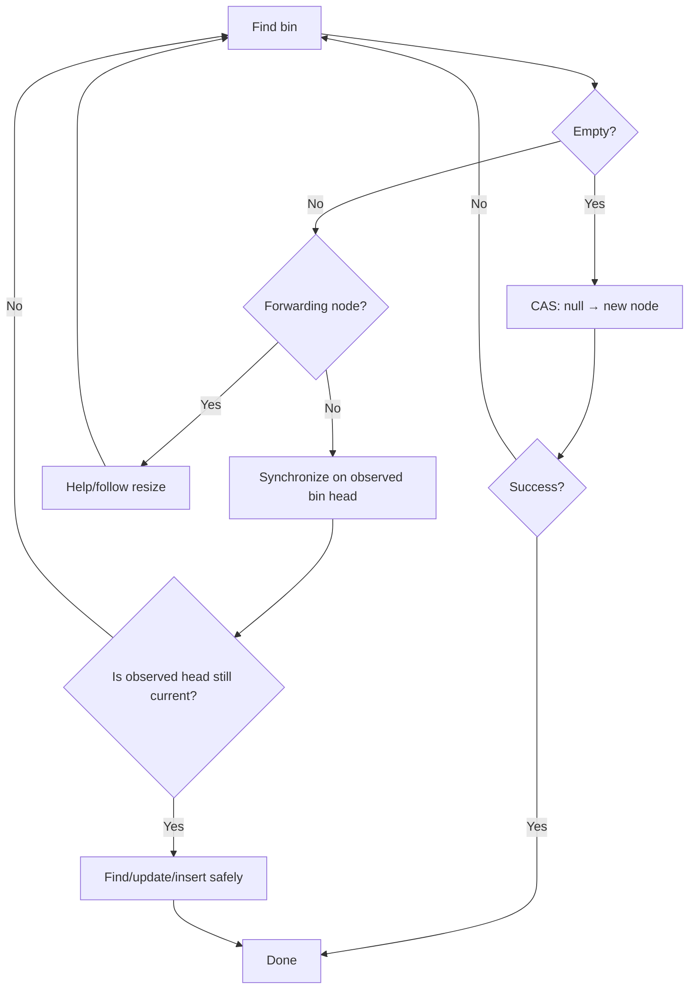
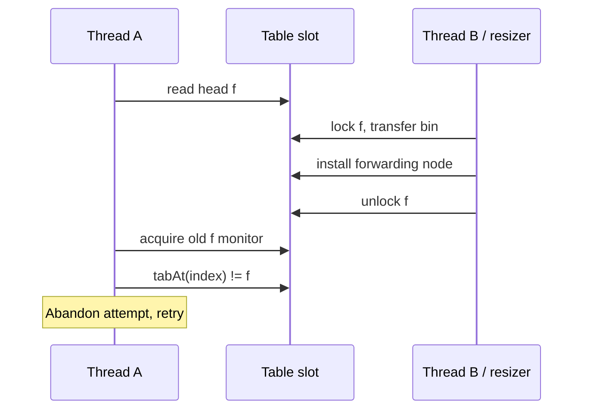
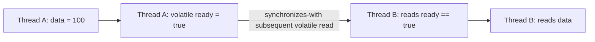
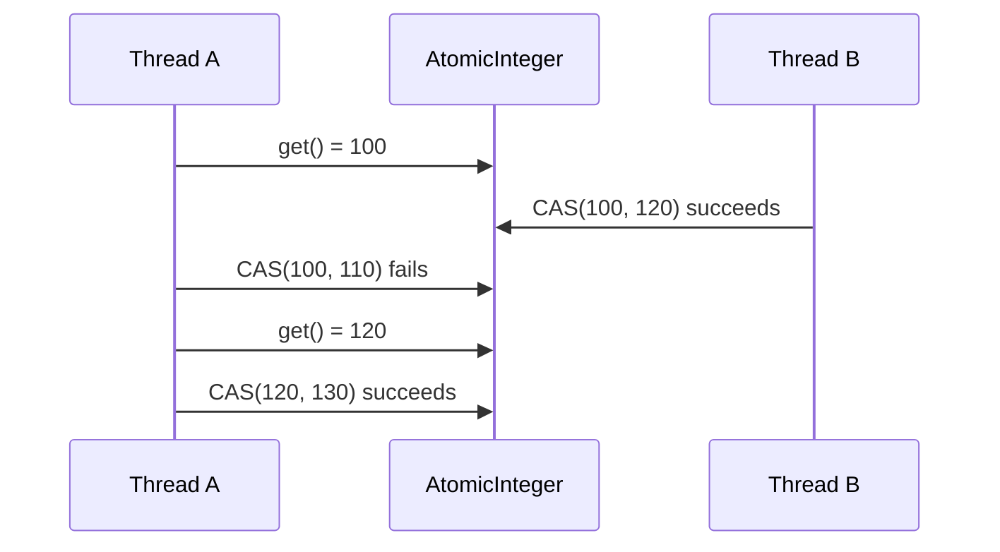
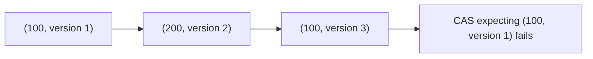

*A practical deep dive from ordinary map operations to the concurrency guarantees that make them correct.*

> **Scope:** Java 8+ concepts, with implementation details described primarily for modern OpenJDK. Internal code snippets are illustrative unless explicitly labeled as API examples. Thread-safety guarantees come from the API contract; internal strategies can change across JDK versions.

## 1. Start with the question: what does “thread-safe” actually mean?

When two threads share a map, several independent correctness questions arise:

1. **Structural integrity:** Can concurrent insertion or resizing lose entries or damage the table?
2. **Visibility:** If a writer publishes a value, can a reader reliably observe it?
3. **Atomicity:** Can a check and its dependent update be interrupted by a competing update?
4. **Business ordering:** If updates carry versions or event order, does the winning update satisfy that rule?

These are different problems. A replacement value can be independent of the old value and still require safe publication and structural protection.

| Operation | Primary concern |
|---|---|
| `get(k)` | Visibility and safe traversal |
| `put(k, v)` | Safe insertion/replacement; last-writer-wins if acceptable |
| `get(k)` then `put(k, f(old))` | Lost update |
| `putIfAbsent(k, v)` | Atomic check-and-insert |
| `computeIfAbsent(k, f)` | Atomic lazy initialization |
| `compute(k, f)` | Atomic read/decide/modify/write |

## 2. HashMap internals: why the loop is usually fast

A hash map stores entries in a table of bins. The hash determines a bin index, often expressed conceptually as:

```java
int index = (table.length - 1) & spread(hashCode);
```

The index calculation is O(1). A bin can still contain multiple nodes due to collisions:



A simplified existing-key replacement loop:

```java
for (Node<K,V> node = table[index]; node != null; node = node.next) {
    if (node.hash == hash && key.equals(node.key)) {
        V previous = node.value;
        node.value = value;
        return previous;
    }
}
```

The loop is **O(k)** for a bin containing *k* nodes. HashMap operations are **expected O(1)** under a reasonable hash distribution and controlled load factor, not guaranteed O(1) for every key. Since Java 8, heavily collided bins can become red-black trees (typically when the bin reaches the treeification threshold and the table is sufficiently large), improving searches in those bins.

### Why not simply use this loop concurrently?

The replacement `node.value = value` does not compute from `previous`, so it does **not** have the classic read-modify-write lost-update problem. Nevertheless, an ordinary `HashMap` has no guarantees for concurrent mutation: readers may not see writes reliably, new nodes may be lost, and resize/traversal may race. “No dependent calculation” is not equivalent to “thread-safe.”

## 3. The two fundamental compound-operation races

### A. Read-modify-write: lost update

Start with `A = 100`. Two threads independently increment by 10 and 20:

```java
int old = map.get("A");
map.put("A", old + delta);
```

```mermaid
sequenceDiagram
    participant T1 as Thread 1 (+10)
    participant M as Map A
    participant T2 as Thread 2 (+20)
    T1->>M: get(A) → 100
    T2->>M: get(A) → 100
    T1->>M: put(A, 110)
    T2->>M: put(A, 120)
    Note over M: Final 120; expected 130
```

Even when both `get()` and `put()` are individually safe, the **sequence** is not atomic.

With `ConcurrentHashMap`:

```java
map.compute("A", (key, current) -> current + 10);
map.compute("A", (key, current) -> current + 20);
```

The two atomic remappings use the result of the preceding one, giving `130` (assuming both complete and no other changes). Handle `null` if the key may be absent.

### B. Check-then-act: competing insertion

```java
if (map.get("A") == null) {
    map.put("A", newValue);
}
```

Both threads can see “absent,” and both can insert. `putIfAbsent` combines the test and insertion:

```java
V previous = concurrentMap.putIfAbsent("A", newValue);
```

Only one competing insertion wins when the mapping is initially absent. The other observes the existing mapping. **This is a special kind of conditional read-modify-write**, not a completely unrelated concept.

## 4. `putIfAbsent` versus `computeIfAbsent`

Both treat a key with no non-null mapping as absent. `HashMap` permits `null` values; `ConcurrentHashMap` does not.

```java
map.putIfAbsent("A", expensiveOperation()); // eager
map.computeIfAbsent("A", key -> expensiveOperation()); // lazy
```

| Question | `putIfAbsent` | `computeIfAbsent` |
|---|---|---|
| When is the candidate value created? | Before method invocation | Only when no mapping exists |
| Return value | Previous value, or `null` | Existing or newly computed value |
| Existing non-null value overwritten? | No | No |
| Atomic in `ConcurrentHashMap`? | Yes | Yes |
| Atomic in ordinary `HashMap` under concurrent mutation? | No | No |

With concurrent calls to `ConcurrentHashMap.computeIfAbsent`, one successful initialization for a key prevents competing calls from duplicating that initialization. The function can run again if it returns `null`, throws, or the mapping is later removed.

The function can technically perform other work, but **avoid slow I/O and non-idempotent side effects** such as charging a customer. Atomic map initialization does not make an external API call exactly-once.

## 5. `compute`: atomic read, decision, and replacement

`compute` is useful even when the *incoming* value was already calculated, because the **decision to accept it** can depend on the current mapping.

```java
map.compute(paymentId, (id, current) -> {
    if (current == null || incoming.version() > current.version()) {
        return incoming;
    }
    return current; // reject older event
});
```

The version must come from an authoritative source; `compute` cannot invent business event order. For payment events, attempt IDs, gateway versions, authoritative status, and allowed transitions can matter more than timestamps alone.

Returning `null` from `compute` removes the mapping (or leaves it absent). Returning `current` keeps it.

**Atomicity scope:** the remapping of the map entry, not the entire thread, not arbitrary side effects in the callback, and not a transaction over several map keys.

## 6. How ConcurrentHashMap makes updates atomic

Modern OpenJDK `ConcurrentHashMap` commonly uses:

- **Empty bin:** CAS to install a first node without taking a bin monitor.
- **Non-empty ordinary bin:** synchronization on the current bin head for mutations.
- **Tree bins and resize:** additional coordination protocols.
- **Reads:** generally non-blocking, with volatile/ordered access.



This is a conceptual flow for `put`-style updates, **not** an exact implementation of `computeIfAbsent` (which can use a reservation node when an empty bin must be computed).

### Why recheck the bin head after acquiring its lock?

```java
Node<K,V> f = tabAt(tab, index);
synchronized (f) {
    if (tabAt(tab, index) == f) {
        // work on current bin
    }
}
```

The thread reads `f` **before** it acquires the monitor. While it waits, another thread can acquire the monitor, transfer the bin during resize, replace the old slot with a forwarding node, and release the monitor. Our thread eventually locks the **old** `f`, so it must validate the slot again.

If the check fails, the enclosing retry loop tries again; it does **not** silently skip the update.



Normal competing updates using the same head lock cannot interleave *inside* the protected section. The validation is needed because **observing a head and obtaining its lock are not one atomic action**.

## 7. Why `get()` does not usually wait for a writer

`ConcurrentHashMap.get()` generally does not acquire a bin monitor. A lookup overlapping a replacement may see the old or new value. If a `put` has completed before the `get` begins, and there is no intervening modification, the lookup sees the updated mapping.

This is different from forcing all readers to wait for writers. Fine-grained synchronization and volatile/ordered reads enable visibility without turning ordinary `get()` into a locking read.

## 8. Java Memory Model: why a loop can keep seeing stale data

Consider a shared ordinary field:

```java
boolean ready = false;

// Thread A
ready = true;

// Thread B
while (!ready) {
    // spin
}
```

The Java Memory Model does **not** guarantee that Thread B exits. The JIT can make optimizations permitted for unsynchronized accesses; repeatedly writing `while` does not itself establish cross-thread visibility.

It is misleading to explain this only as “the CPU cache takes a little time to refresh.” Modern CPUs usually maintain cache coherence; the Java-level issue is the **absence of a happens-before relationship**, which leaves compiler transformations and observable ordering insufficiently constrained.

```java
volatile boolean ready = false;
```

A volatile read cannot simply be replaced by indefinitely reusing an earlier ordinary read. Volatile also establishes ordering guarantees.

### Visibility is not the same as atomicity

`volatile int count` makes reads/writes visible but does not make `count++` atomic: increment still involves reading, adding, and writing. Use `AtomicInteger.incrementAndGet()`, `compute`, or suitable locking for dependent updates.

## 9. The surprising part: volatile publishes earlier ordinary writes

```java
int data = 0;
volatile boolean ready = false;

// Thread A
data = 100;
ready = true;

// Thread B
if (ready) {
    System.out.println(data); // 100, assuming no other writes to data
}
```

Why is this not “obvious” even though Thread A wrote `data` first? **Source-code order inside Thread A does not, by itself, establish cross-thread visibility.** Without synchronization, Thread B could observe `ready == true` but still observe `data == 0`.

With `volatile`, the ordering is:



Program order + volatile synchronization + transitivity establish:

`write data` **happens-before** `read data`.

The guarantee concerns **observable memory effects**, not a requirement that the CPU literally execute all machine instructions in source order.

### Does volatile make Thread B wait?

**No.** If Thread B reads `false`, it proceeds according to its code (or loops if *you* wrote a loop). If it observes the published `true`, the preceding writes are visible. `volatile` does not automatically block a thread until a producer finishes.

Nor does it wait for unrelated asynchronous operations:

```java
startAsyncDatabaseUpdate();
ready = true; // Does not mean the database update has finished!
```

If a thread must **wait for completion**, prefer a coordination primitive such as `CountDownLatch`, `Future`, or a condition.

## 10. What exactly is “happens-before”?

Happens-before is a **memory-ordering and visibility relationship**, not a scheduler instruction saying “run all of Thread A before Thread B.”

Key sources of happens-before include:

- Program order within a thread.
- Unlocking a monitor before another thread subsequently locks that monitor.
- A volatile write before a subsequent volatile read of the same variable.
- Thread start/join rules and guarantees of concurrency utilities.

If A happens-before B, effects of A must be observable consistently at B. The runtime may reorder internal instructions **only when the resulting execution still obeys these guarantees**.

The volatile publication example guarantees `data == 100` after Thread B observes `ready == true`, provided there are no other conflicting writes to `data`.

### Safe publication and “half-baked” objects

A normal `HashMap` does not by itself safely publish an object to a concurrent reader. Under unsafe publication, another thread might observe a reference without guaranteed visibility of all non-final fields initialized before publication. `ConcurrentHashMap` provides the needed publication relationship for values placed into and subsequently retrieved from the map. **Later mutations to the object still need their own synchronization.**

## 11. CAS: compare-and-set, not automatic retry

CAS atomically performs:

> If the current value equals the expected value, replace it; otherwise report failure.

Java exposes it as `compareAndSet`:

```java
AtomicInteger n = new AtomicInteger(100);
boolean changed = n.compareAndSet(100, 110);
```

One `compareAndSet` call is **one attempt**. Retrying is a separate policy:

```java
int observed;
do {
    observed = n.get();
} while (!n.compareAndSet(observed, observed + 10));
```



A retry loop has no intrinsic time limit; an individual thread can repeatedly lose under contention. Lock-free does not mean wait-free. Higher-level atomic methods may use platform atomic instructions or retries internally.

## 12. ABA: same value, different history

CAS tests the **current** value, not whether the value changed at any point:

`100 → 200 → 100`

A CAS expecting `100` can succeed, even though another thread modified the value twice. This is only a bug if the algorithm relies on “same value means unchanged history.”

A version/stamp distinguishes these states:



Java offers `AtomicStampedReference<T>` for reference + stamp CAS. It compares references by **identity**, not `.equals()`. The stamp must advance correctly, and wraparound/reuse must be considered in a complete design.

Other strategies include immutable object identity, locks, and safe memory-reclamation techniques in specialized lock-free structures. `AtomicMarkableReference` only tracks a boolean mark and is not a general version counter.

## 13. AtomicInteger versus ConcurrentHashMap.compute

```java
AtomicInteger total = new AtomicInteger(100);
total.addAndGet(10);
```

This atomically changes **one integer**.

```java
ConcurrentHashMap<String, Integer> totals = new ConcurrentHashMap<>();
totals.put("A", 100);
totals.compute("A", (k, v) -> v + 10);
```

This atomically remaps **one map entry**.

You can combine the two:

```java
ConcurrentHashMap<String, AtomicInteger> counters =
    new ConcurrentHashMap<>();
counters.computeIfAbsent("A", k -> new AtomicInteger())
        .incrementAndGet();
```

But if another thread replaces the `AtomicInteger` object in the map, an increment on a previously retrieved counter can affect the **old** object. Atomicity of the integer and atomicity of the map reference are separate.

## 14. Concurrency safety versus business correctness

Two independent `put()` calls are not a classic lost-update race:

```java
map.put("theme", "DARK");
map.put("theme", "LIGHT");
```

If “whichever write takes effect last wins” is acceptable, `put` is sufficient **in a thread-safe map**. But the map cannot know whether that order corresponds to the order of user actions or gateway events.

A payment status example illustrates the difference: a delayed failure event from an older attempt must not necessarily overwrite a successful later attempt. Atomic replacement alone cannot decide which event is authoritative; use gateway attempt IDs, versions, authoritative status, and transition rules.

This also clarifies the database analogy. PostgreSQL `REPEATABLE READ` intentionally maintains a transaction snapshot; a racy `HashMap` does **not** maintain snapshots. PostgreSQL `READ COMMITTED` ordinary `SELECT` statements generally read a committed MVCC version rather than waiting for an uncommitted writer. The analogy is about **what is observable**, not identical implementation.

## 15. Designing a concurrent map in an interview

A strong design progression is:

1. Build a basic hash table with bins, collision handling, and resizing.
2. Protect all operations with one lock: correct but low concurrency.
3. Introduce striped/bin-level locks for independent updates.
4. Add safe publication and non-blocking reads where possible.
5. Make check-and-insert and remapping operations atomic.
6. Coordinate resizing and revalidate bin heads after acquiring locks.
7. Discuss CAS failures, retry, contention, and progress guarantees.

A synchronized baseline:

```java
class SimpleSynchronizedMap<K,V> {
    private final Map<K,V> delegate = new HashMap<>();

    public synchronized V get(K key) {
        return delegate.get(key);
    }

    public synchronized V put(K key, V value) {
        return delegate.put(key, value);
    }

    public synchronized V putIfAbsent(K key, V value) {
        return delegate.putIfAbsent(key, value);
    }
}
```

This is correct for access through these methods but serializes all readers and writers. A production-grade `ConcurrentHashMap` is considerably more complex.

## 16. Quick mental model

| Mechanism | What it solves | What it does not automatically solve |
|---|---|---|
| `volatile` | Visibility and ordering | `count++`, multi-step atomicity |
| CAS | One atomic conditional update | History detection (ABA), guaranteed per-thread progress |
| `synchronized` | Mutual exclusion + visibility for cooperating lock users | Unrelated operations outside the lock |
| `putIfAbsent` on CHM | Atomic check-and-insert | Update of existing non-null mapping |
| `computeIfAbsent` on CHM | Atomic lazy initialization | Exactly-once external side effects |
| `compute` on CHM | Atomic per-key remapping | Multi-key transactions or external business ordering |
| `CountDownLatch` | Wait for a completion signal + visibility | Arbitrary transactional consistency |

### Interview-ready conclusion

> Atomicity is about the **boundary of an operation**, not the whole thread. Visibility is about whether one thread can reliably observe another thread's writes. `ConcurrentHashMap` combines these guarantees with fine-grained coordination so independent operations can proceed concurrently, while compound operations such as `putIfAbsent` and `compute` remain correct.

### References for deeper reading

- [Java `ConcurrentHashMap` API documentation](https://docs.oracle.com/en/java/javase/21/docs/api/java.base/java/util/concurrent/ConcurrentHashMap.html)
- [Java `Map` API documentation](https://docs.oracle.com/en/java/javase/21/docs/api/java.base/java/util/Map.html)
- [Java Language Specification §17: Threads and Locks](https://docs.oracle.com/javase/specs/jls/se21/html/jls-17.html)
- [Java `AtomicInteger` API](https://docs.oracle.com/en/java/javase/21/docs/api/java.base/java/util/concurrent/atomic/AtomicInteger.html)
- [Java `AtomicStampedReference` API](https://docs.oracle.com/en/java/javase/21/docs/api/java.base/java/util/concurrent/atomic/AtomicStampedReference.html)
